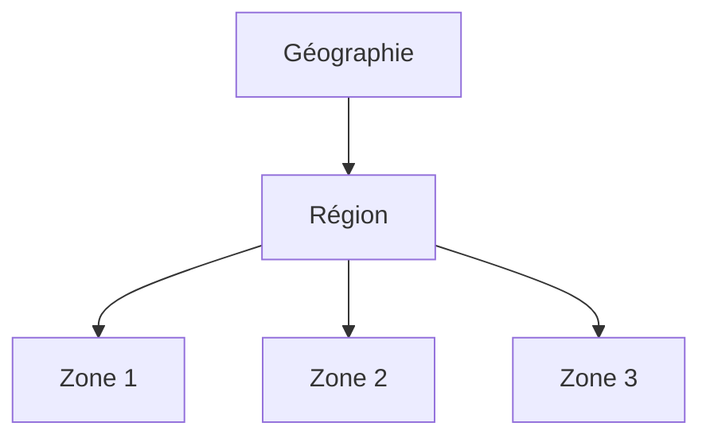

# Infrastructure globale d'Azure

## 1. Définition simple
Azure est un réseau mondial de datacenters organisé en **géographies**, **régions**, **zones** et **datacenters**.

## 2. Les niveaux
| Niveau | Définition |
|---|---|
| Géographie | Groupe de régions, avec exigences de résidence des données |
| Région | Zone géographique avec un ou plusieurs datacenters |
| Availability Zone | Emplacement physique séparé dans une région (alimentation, refroidissement, réseau indépendants) |
| Datacenter | Bâtiment hébergeant les serveurs |

Une région compatible compte au minimum trois zones. Toutes les régions ne les supportent pas, ni tous les services : vérifiez chaque cas.

## 3. Régions appariées ou non
- Certaines régions sont **appariées** avec une autre de la même géographie ; quelques services s'en servent pour la géo-réplication.
- Beaucoup de régions récentes sont **non appariées** et s'appuient sur les zones.
- Dans les deux cas, il faut concevoir et tester son propre plan de reprise après sinistre.

## 4. Choisir une région
Latence, conformité et résidence des données, services disponibles, prix, support des zones.

Nombre de régions : voir la [carte officielle](https://datacenters.microsoft.com/globe/explore), ce chiffre évolue.

## 5. À retenir
- Zones = résilience dans une région ; plusieurs régions = résilience face à un sinistre régional.
- Ne pas supposer que toutes les régions offrent les mêmes services.

Détail dans le [chapitre 11](../11-high-availability-and-disaster-recovery/availability-zones-and-sets.md).

## 6. Questions d'entretien
- Différence entre zone de disponibilité et région ?
- Pourquoi la paire de régions ne suffit-elle pas comme plan de reprise ?

## 7. QCM
**Q1.** Une Availability Zone protège surtout contre :
A) Panne de région B) Panne de datacenter C) Erreur humaine
**Réponse : B.**

**Q2.** Qu'est-ce qui regroupe des régions selon la résidence des données ?
A) Géographie B) Tag C) Resource group
**Réponse : A.**

## 8. Documentation officielle
- [Régions Azure](https://learn.microsoft.com/azure/reliability/regions-overview)
- [Paires et régions non appariées](https://learn.microsoft.com/azure/reliability/regions-paired)
