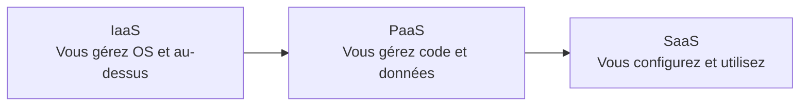

# IaaS, PaaS, SaaS et serverless

## 1. Définition simple
Ces modèles indiquent **ce que le fournisseur gère pour vous** et ce qui reste à votre charge.

> Analogie : IaaS = louer la cuisine, PaaS = commander les ingrédients prêts à cuisiner, SaaS = manger au restaurant.

## 2. Qui gère quoi
| Couche | IaaS | PaaS | SaaS |
|---|---|---|---|
| Application | Vous | Vous | Fournisseur |
| Données | Vous | Vous | Vous |
| Runtime | Vous | Fournisseur | Fournisseur |
| Système d'exploitation | Vous | Fournisseur | Fournisseur |
| Matériel, réseau, datacenter | Fournisseur | Fournisseur | Fournisseur |

## 3. Exemples Azure
| Modèle | Exemples |
|---|---|
| IaaS | [Virtual Machines](../05-compute-and-hosting/virtual-machines.md) |
| PaaS | [App Service](../05-compute-and-hosting/app-service.md), [Azure SQL](../06-storage-and-databases/azure-sql.md) |
| Serverless | [Azure Functions](../05-compute-and-hosting/azure-functions.md) |
| SaaS | Microsoft 365 |

Le **serverless** est souvent vu comme un PaaS poussé plus loin : pas de serveur à gérer, facturation à l'exécution. Les classifications varient selon les sources.

Plus on avance vers la droite, moins on gère, mais moins on contrôle.

## 4. À retenir
- IaaS = contrôle maximal, PaaS = productivité, SaaS = prêt à l'emploi.
- Les données restent toujours sous votre responsabilité.

## 5. Questions d'entretien
- Quand préférer IaaS à PaaS ?
- Où placer le serverless ?

## 6. QCM
**Q1.** Qui patche l'OS d'une VM Azure ?
A) Microsoft B) Le client C) Personne
**Réponse : B.**

**Q2.** Quel service est du PaaS ?
A) Virtual Machines B) App Service C) Datacenter local
**Réponse : B.**

## 7. Documentation officielle
- [Types de services cloud](https://azure.microsoft.com/resources/cloud-computing-dictionary/what-are-iaas-paas-saas)
