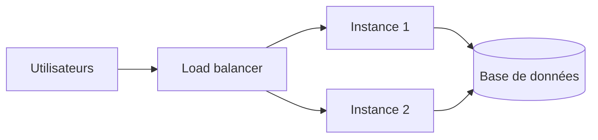

# Scalabilité et disponibilité

## 1. Définitions simples
- **Scalabilité** : gérer plus de charge en ajoutant des ressources.
- **Élasticité** : ajouter ou retirer des ressources automatiquement selon la charge.
- **Haute disponibilité** : rester accessible malgré des pannes.

## 2. Verticale ou horizontale
| | Verticale (scale up) | Horizontale (scale out) |
|---|---|---|
| Principe | Machine plus puissante | Plus d'instances |
| Limite | Taille maximale d'une machine | Application sans état local |

## 3. SLA
Un **SLA** est l'engagement de disponibilité d'un service. Valeurs actuelles : [SLA Azure](https://azure.microsoft.com/support/legal/sla/).

**SLA composite** : deux services en série, on multiplie. Exemple : 99,95 % × 99,99 % ≈ 99,94 %. Plus il y a de dépendances en série, plus le SLA global baisse.

Si une instance tombe, l'autre prend le relais. La base reste à rendre redondante ([chapitre 11](../11-high-availability-and-disaster-recovery/autoscaling-and-load-balancing.md)).

## 4. À retenir
- Préférer le scale out pour l'élasticité.
- Haute disponibilité (pannes locales) ≠ reprise après sinistre (perte d'une région).

## 5. Questions d'entretien
- Comment rendre une application web scalable horizontalement ?

## 6. QCM
**Q1.** Ajouter des instances pour absorber la charge :
A) Scale up B) Scale out C) Failover
**Réponse : B.**

**Q2.** Deux services en série à 99,9 % chacun : SLA composite ?
A) 99,9 % B) Environ 99,8 % C) 100 %
**Réponse : B.** 0,999 × 0,999 ≈ 0,998.

## 7. Documentation officielle
- [Fiabilité (Well-Architected Framework)](https://learn.microsoft.com/azure/well-architected/reliability/)
