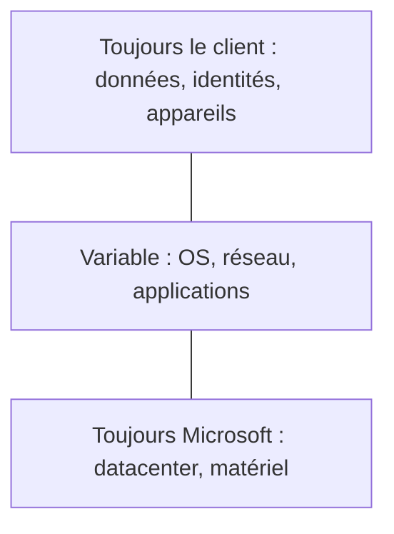

# Modèle de responsabilité partagée

## 1. Définition simple
En cloud, **Microsoft et le client se partagent la sécurité**. La part de chacun dépend du modèle (IaaS, PaaS, SaaS).

> Analogie : Microsoft sécurise l'immeuble, vous fermez la porte de votre appartement.

## 2. Qui gère quoi
| Responsabilité | IaaS | PaaS | SaaS |
|---|---|---|---|
| Données, identités, appareils | Client | Client | Client |
| Applications | Client | Partagé | Microsoft |
| Système d'exploitation | Client | Microsoft | Microsoft |
| Datacenter, matériel, réseau physique | Microsoft | Microsoft | Microsoft |

Tableau synthétique : la version de référence est dans la documentation officielle.

## 3. Exemple
Un stockage Blob rendu public par erreur ou un compte admin sans MFA relèvent de la responsabilité du client.

## 4. À retenir
- Données, identités et appareils : toujours le client.
- Microsoft gère davantage en allant de IaaS vers SaaS.

## 5. Questions d'entretien
- Qui est responsable d'une fuite due à un stockage public ?

## 6. QCM
**Q1.** Quelle responsabilité reste toujours au client ?
A) Datacenter B) Données C) Hyperviseur
**Réponse : B.**

**Q2.** En PaaS, qui gère l'OS ?
A) Le client B) Microsoft
**Réponse : B.**

## 7. Documentation officielle
- [Responsabilité partagée](https://learn.microsoft.com/azure/security/fundamentals/shared-responsibility)
