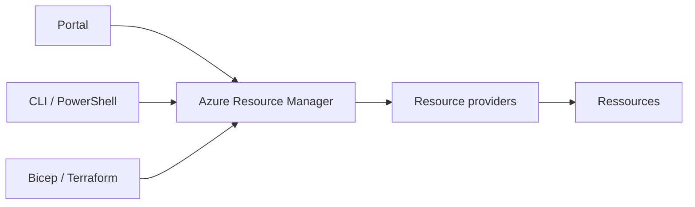

# Azure Resource Manager (ARM)

## 1. Définition simple
**Azure Resource Manager** est le service qui reçoit **toutes** les demandes de création, modification ou suppression de ressources, quel que soit l'outil utilisé.

> Analogie : le guichet unique d'Azure.

## 2. Ce qu'il fait
1. Authentifie la demande (via [Entra ID](entra-tenant.md)).
2. Vérifie les droits ([RBAC](../03-identity-and-security/azure-rbac.md)), les policies et les locks.
3. Transmet la demande au bon resource provider.

Quel que soit l'outil, le résultat et les contrôles sont les mêmes.

## 3. Déploiement déclaratif
Avec des templates ([Bicep](../08-devops-and-infrastructure-as-code/bicep.md), ARM templates), on décrit l'**état voulu** et ARM s'occupe de l'atteindre. Redéployer le même template doit donner le même résultat.

## 4. Avantages
- Interface unique et cohérente.
- Droits, policies, tags et locks appliqués partout.
- Déploiements reproductibles.

## 5. Erreurs fréquentes
- Croire que le Portal fait quelque chose de différent de la CLI.
- Modifier à la main des ressources déployées par code.

## 6. À retenir
- Tous les outils passent par ARM.
- ARM applique les contrôles avant de créer quoi que ce soit.

## 7. Questions d'entretien
- Que se passe-t-il entre un `az group create` et la création effective ?

## 8. QCM
**Q1.** Par quel service passent toutes les demandes de gestion de ressources ?
A) Azure Monitor B) Azure Resource Manager C) Azure Advisor
**Réponse : B.**

**Q2.** Un template décrit :
A) Les étapes à suivre B) L'état voulu C) Les logs
**Réponse : B.**

## 9. Documentation officielle
- [Azure Resource Manager](https://learn.microsoft.com/azure/azure-resource-manager/management/overview)
