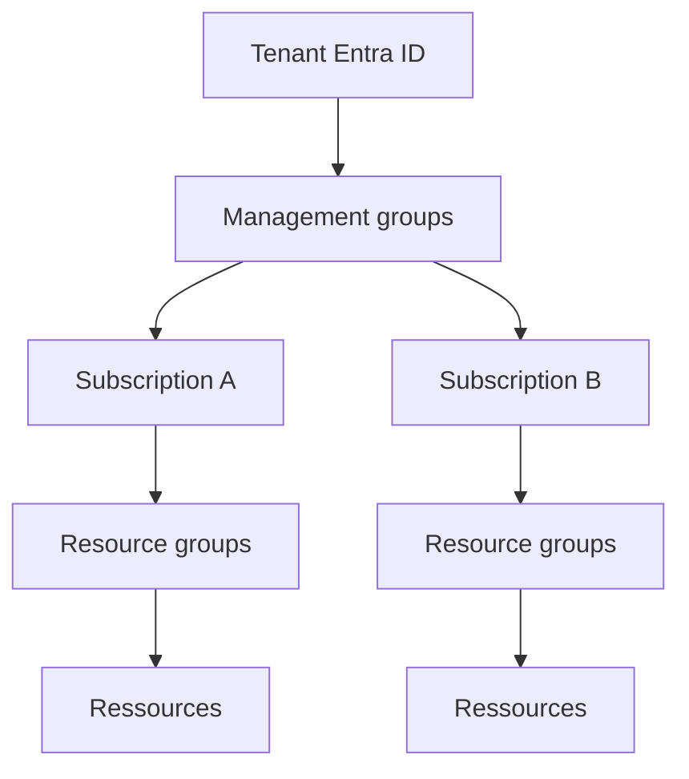

# Microsoft Entra Tenant

## 1. Définition simple
Un **tenant** est l'espace privé d'une organisation dans Microsoft Entra ID (anciennement Azure Active Directory). Il contient ses **identités** : utilisateurs, groupes et applications.

> Analogie : le tenant est l'annuaire de l'entreprise. Azure demande à cet annuaire « qui est cette personne ? ».

## 2. À quoi ça sert
- Centraliser les identités de l'organisation.
- Servir de point d'authentification pour Azure et Microsoft 365.
- Servir de racine à toute l'organisation Azure.

## 3. Ce qu'il faut savoir
| Élément | Détail |
|---|---|
| Tenant ID | Identifiant unique (GUID) |
| Domaine initial | `nom.onmicrosoft.com` |
| Domaines personnalisés | Ex. `masociete.com`, ajoutés et vérifiés |
| Identités | Utilisateurs, invités, groupes, principaux de service |

## 4. Tenant et subscription
- Une **subscription** fait confiance à **un seul** tenant.
- Un tenant peut avoir **plusieurs** subscriptions.

Explication : le tenant est au sommet. En dessous viennent les management groups, les subscriptions, les resource groups puis les ressources (voir [management-groups.md](management-groups.md) et [subscriptions.md](subscriptions.md)).

## 5. À ne pas confondre
| Service | Rôle |
|---|---|
| **Entra ID** | Qui es-tu ? (identités) |
| **Azure RBAC** | Que peux-tu faire sur les ressources ? ([voir](../03-identity-and-security/azure-rbac.md)) |

Un tenant n'est pas un « compte Azure » et n'est pas non plus une subscription.

## 6. Erreurs fréquentes
- Confondre tenant et subscription.
- Créer plusieurs tenants sans raison, ce qui complique la gestion des identités.
- Ignorer le tenant utilisé quand on a plusieurs comptes (personnel, école, entreprise).

## 7. À retenir
- Tenant = annuaire d'identités d'une organisation.
- 1 subscription → 1 tenant ; 1 tenant → N subscriptions.
- Entra ID gère les identités, RBAC gère les droits.

## 8. Questions d'entretien
- Quelle différence entre un tenant et une subscription ?
- Une subscription peut-elle dépendre de deux tenants ?

## 9. QCM
**Q1.** Combien de tenants une subscription peut-elle approuver ?
A) 0 B) 1 C) 2 D) Illimité
**Réponse : B.** Une subscription est liée à un seul tenant.

**Q2.** Qu'est-ce qui contient les utilisateurs et les groupes ?
A) Resource group B) Management group C) Tenant Entra ID D) Subscription
**Réponse : C.**

## 10. Documentation officielle
- [Qu'est-ce que Microsoft Entra ID ?](https://learn.microsoft.com/entra/fundamentals/whatis)
- [Associer une subscription à un tenant](https://learn.microsoft.com/azure/active-directory/fundamentals/how-subscriptions-associated-directory)
