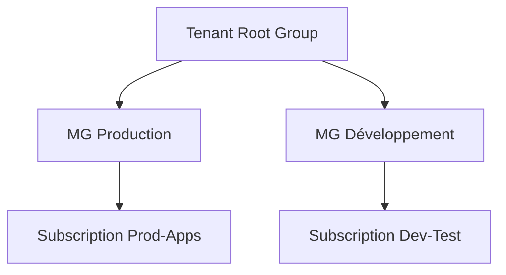

# Management Groups

## 1. Définition simple
Un **management group** est un dossier qui regroupe plusieurs subscriptions pour leur appliquer les mêmes règles et les mêmes droits.

> Analogie : un département qui regroupe plusieurs équipes.

## 2. Pourquoi
Sans eux, il faudrait configurer chaque subscription séparément. Avec eux, une règle posée en haut s'applique à tout ce qui est dessous (**héritage**).

## 3. Ce qu'il faut savoir
- Il existe toujours un groupe racine, le **Tenant Root Group**.
- Une subscription appartient à **un seul** management group à la fois.
- Les groupes peuvent être imbriqués, avec une profondeur limitée.
- On y applique [Azure RBAC](../03-identity-and-security/azure-rbac.md) et [Azure Policy](../09-governance-and-cost-management/azure-policy.md).

Une règle posée sur « Production » s'applique à `Prod-Apps` et à tout son contenu.

## 4. Exemple
Un MG « Production » avec une policy interdisant certaines régions : toutes ses subscriptions la respectent automatiquement.

## 5. Erreurs fréquentes
- Poser des droits trop larges au niveau racine.
- Créer une hiérarchie trop profonde et illisible.
- Confondre management group (regroupe des subscriptions) et resource group (regroupe des ressources).

## 6. À retenir
- Management group = regroupement de subscriptions.
- Les droits et policies sont hérités vers le bas.

## 7. Questions d'entretien
- Quelle différence entre management group et resource group ?

## 8. QCM
**Q1.** Un management group regroupe :
A) Des ressources B) Des subscriptions C) Des utilisateurs
**Réponse : B.**

**Q2.** Combien de management groups parents directs peut avoir une subscription ?
A) 0 B) 1 C) Plusieurs
**Réponse : B.**

## 9. Documentation officielle
- [Management groups](https://learn.microsoft.com/azure/governance/management-groups/overview)
