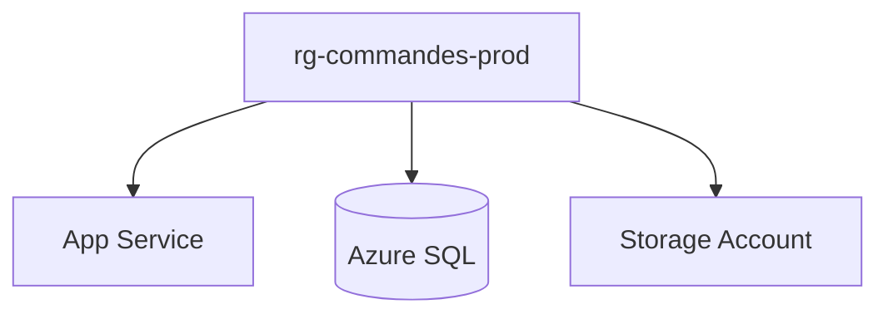

# Resource Groups

## 1. Définition simple
Un **resource group** est un conteneur logique qui regroupe les ressources d'une même application ou d'un même cycle de vie.

> Analogie : un dossier de projet.

## 2. Règles clés
- Une ressource appartient à **un seul** resource group.
- Les resource groups ne s'imbriquent pas.
- Les ressources d'un groupe peuvent être dans des régions différentes ; la région du groupe sert aux métadonnées.
- Supprimer un groupe **supprime toutes ses ressources**.
- On peut y appliquer RBAC, policies, tags et locks.

## 3. Comment les organiser
Regrouper ce qui est **déployé, mis à jour et supprimé ensemble**. Exemple : `rg-commandes-prod` pour l'App Service, la base et le stockage de l'application.



## 4. Commandes (à tester sur votre compte)
```bash
az group create --name rg-commandes-dev --location francecentral
az group list -o table
az group delete --name rg-commandes-dev --yes
```

## 5. Erreurs fréquentes
- Un seul groupe fourre-tout pour tout.
- Mélanger des ressources aux cycles de vie différents.
- Supprimer un groupe sans vérifier son contenu.

## 6. À retenir
- Resource group = cycle de vie commun.
- Suppression du groupe = suppression de tout son contenu.

## 7. Questions d'entretien
- Peut-on imbriquer des resource groups ?
- Comment décider de ce qui va dans le même groupe ?

## 8. QCM
**Q1.** Une ressource peut appartenir à :
A) Un seul resource group B) Plusieurs C) Aucun
**Réponse : A.**

**Q2.** Que se passe-t-il si on supprime un resource group ?
A) Rien B) Ses ressources sont supprimées C) Elles sont déplacées
**Réponse : B.**

## 9. Documentation officielle
- [Resource groups](https://learn.microsoft.com/azure/azure-resource-manager/management/manage-resource-groups-portal)
