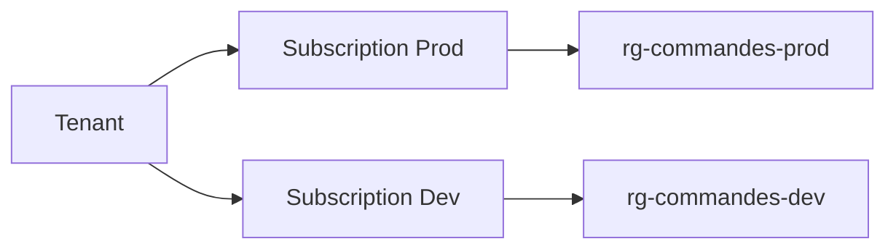

# Subscriptions

## 1. Définition simple
Une **subscription** est le conteneur de facturation et d'accès dans lequel on crée ses ressources.

> Analogie : un compte bancaire dédié à un projet : chaque dépense y est rattachée.

## 2. Trois frontières
| Frontière | Signification |
|---|---|
| Facturation | Les coûts sont regroupés par subscription |
| Accès | On peut donner des droits à ce niveau |
| Échelle | Les quotas et limites s'appliquent par subscription |

## 3. Ce qu'il faut savoir
- Une subscription fait confiance à **un seul** [tenant](entra-tenant.md).
- Plusieurs subscriptions sont courantes : production, développement, par équipe ou par client.
- Les types d'offres varient (essai gratuit, paiement à l'usage, contrat entreprise, etc.) : consultez la documentation pour les offres actuelles.

## 4. Quand en créer une nouvelle
- Séparer production et test.
- Isoler les coûts d'une équipe ou d'un client.
- Contourner les limites de quotas.
- Appliquer des règles d'accès différentes.

## 5. Erreurs fréquentes
- Tout mettre dans une seule subscription.
- Oublier de supprimer les ressources de test et payer pour rien.

## 6. À retenir
- Subscription = facturation + accès + limites.
- 1 subscription → 1 tenant.

## 7. Questions d'entretien
- Pourquoi utiliser plusieurs subscriptions ?

## 8. QCM
**Q1.** Que regroupe une subscription pour la facturation ?
A) Les coûts de ses ressources B) Les utilisateurs C) Les tags
**Réponse : A.**

**Q2.** Les quotas s'appliquent par :
A) Tag B) Subscription C) Ressource
**Réponse : B.**

## 9. Documentation officielle
- [Subscriptions Azure](https://learn.microsoft.com/azure/cloud-adoption-framework/ready/azure-best-practices/organize-subscriptions)
